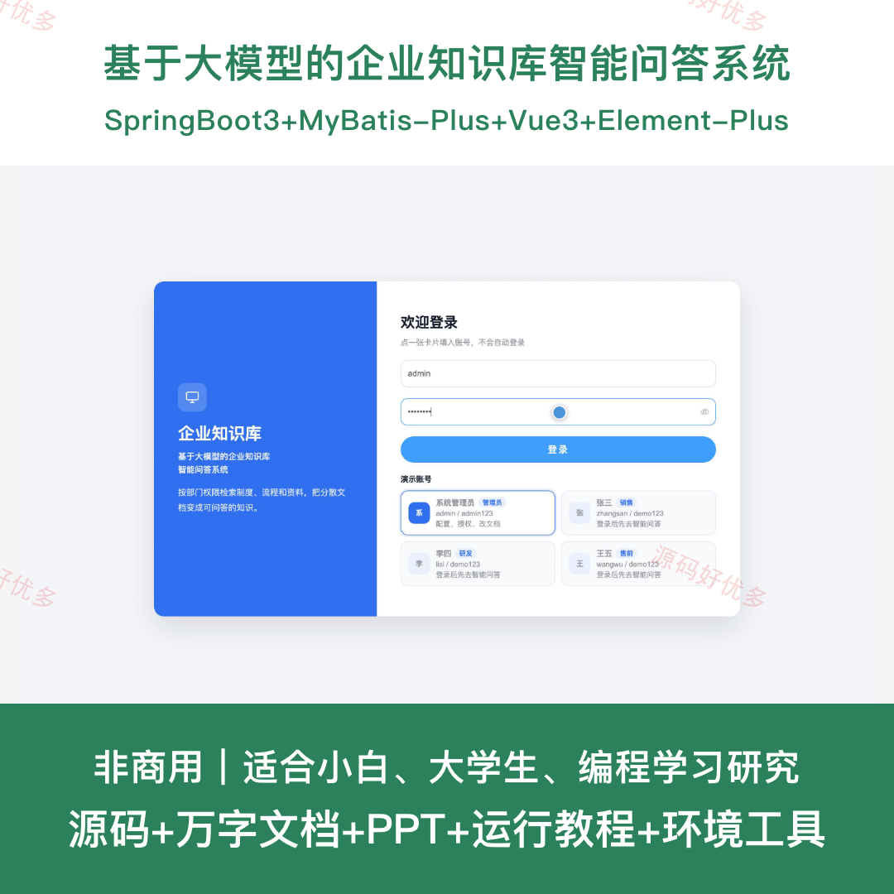
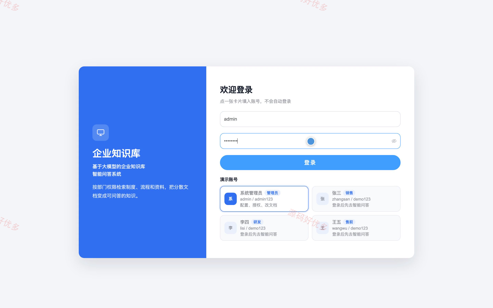
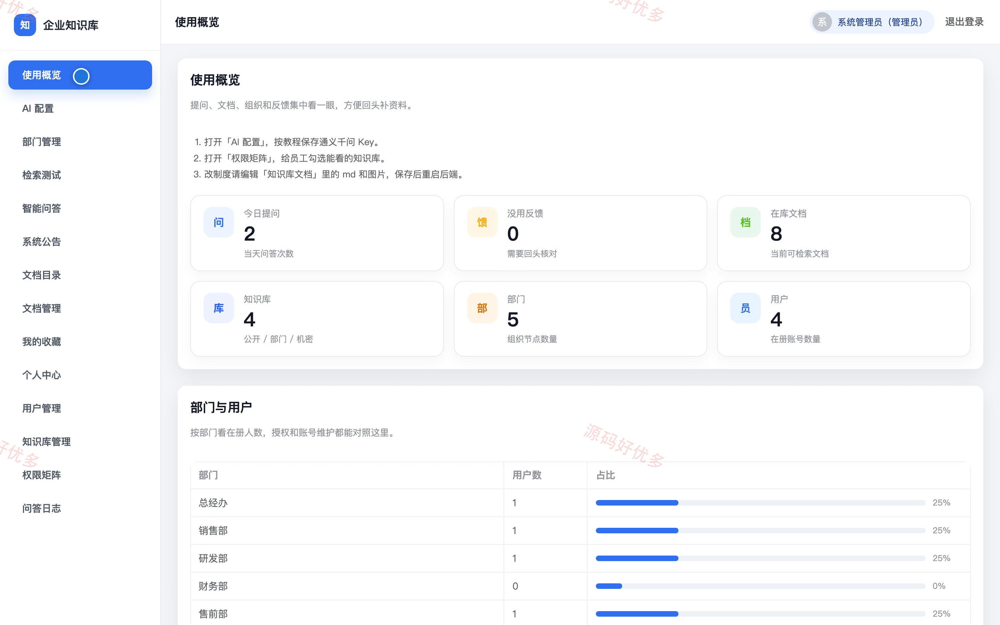
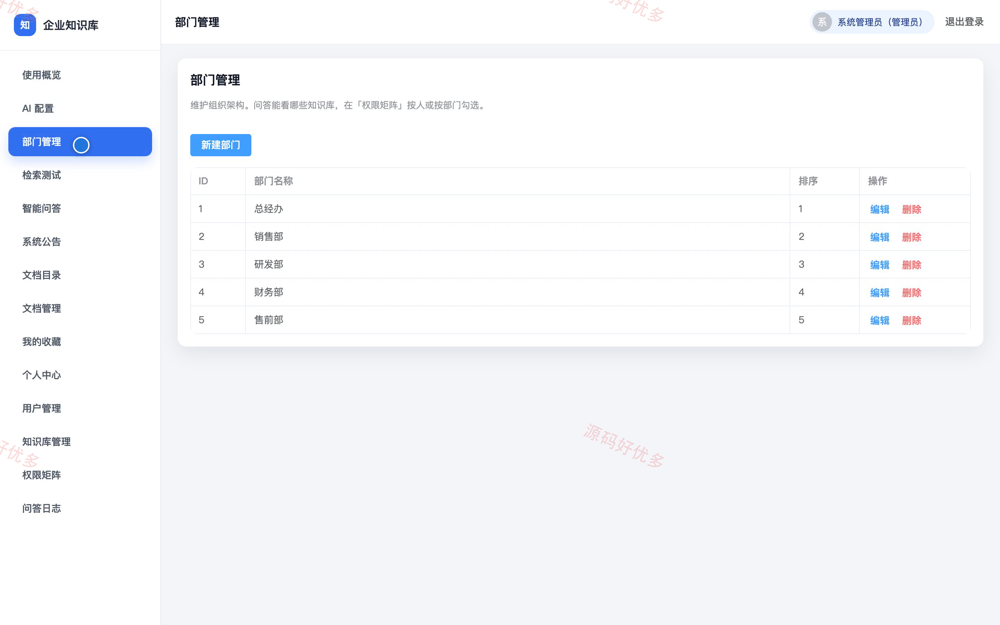
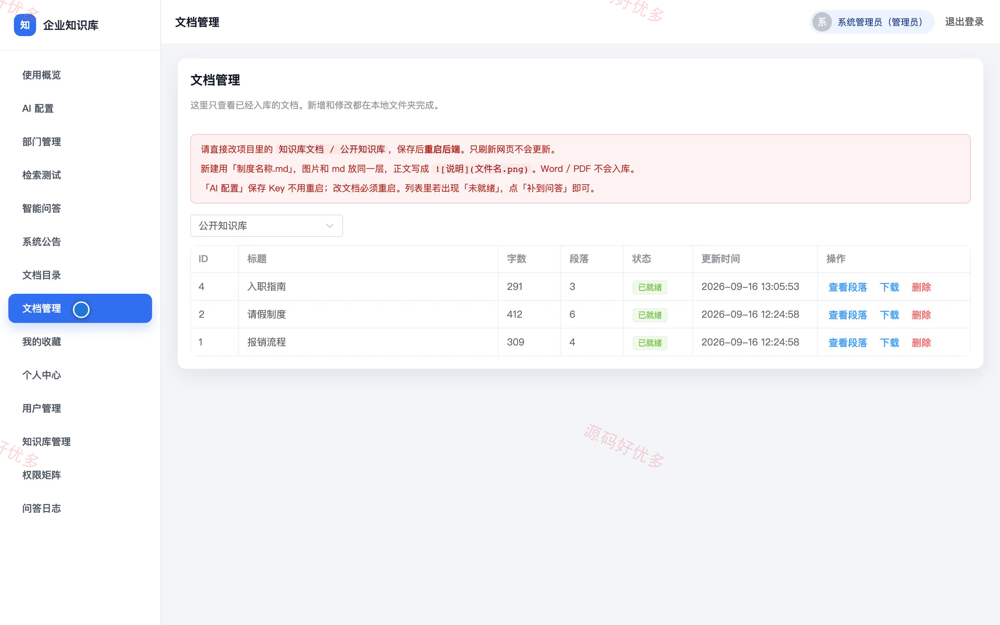
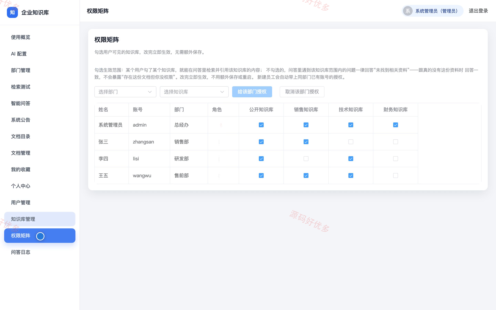
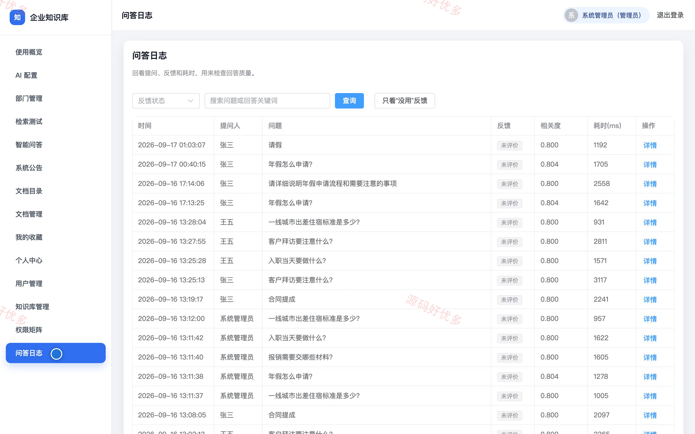
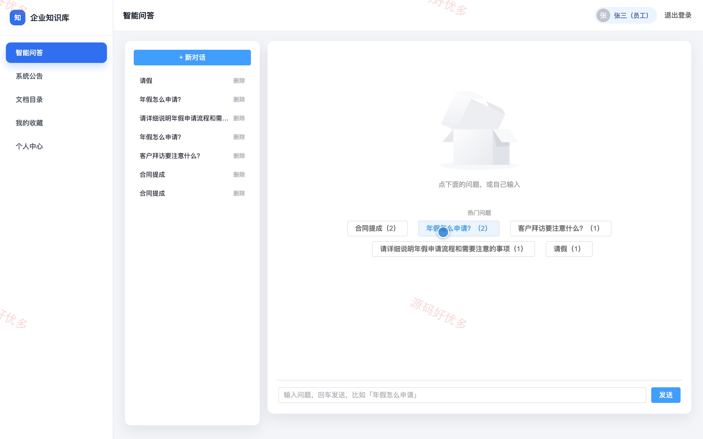
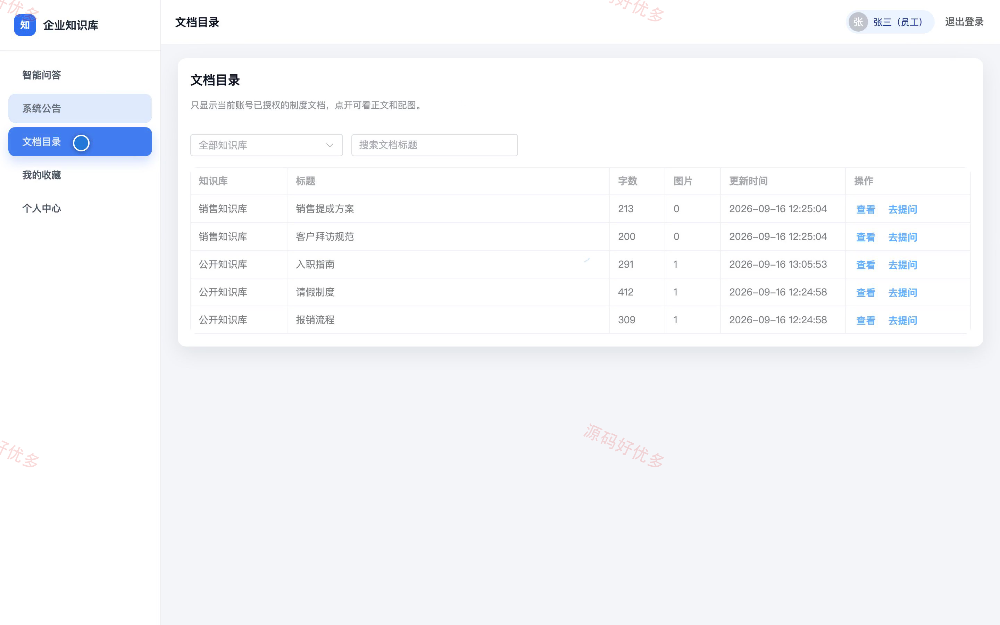

## 源码问题查看主页咨询

### 一、关键词
企业知识库、智能问答、知识检索、权限管理、问答溯源

### 二、作品包含
源码+数据库+万字设计文档+PPT+全套环境和工具资源+本地部署教程

### 三、项目技术
前端技术： Html、Css、Js、Vue3.4、Element-Plus
后端技术：Java、SpringBoot3.2.5、MyBatis-Plus

### 四、运行环境要求
开发工具：IDEA/eclipse + VSCODE

数据库：MySQL5.7+（共12张表）

数据库管理工具：Navicat10以上版本

环境配置软件： JDK17 + Maven3.6

前端Nodejs：16+

浏览器：谷歌浏览器

### 五、项目介绍
项目编号：bs162A

本系统面向企业内部知识查询场景，将制度、流程与部门资料按知识库统一组织。员工只能在已授权范围内检索并发起智能问答，系统返回带来源的回答；管理员负责维护知识库、文档、组织用户、授权矩阵与问答日志。

角色：管理员、员工

管理员功能：使用概览、AI配置、部门与用户管理、知识库与文档管理、权限矩阵、检索测试、问答日志、系统公告管理。

员工功能：智能问答、问答会话管理、回答来源查看、问答反馈、问答收藏、授权文档目录查看、系统公告查看、个人资料与密码维护。

### 六、运行截图

